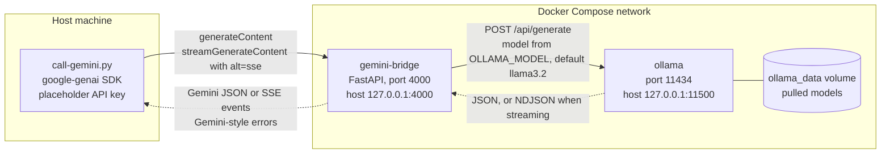

# Local Gemini Sandbox

Run code written for the Google Gen AI SDK (`google-genai`) against a local LLM, with no Google Cloud account, billing, or real API key.

A small FastAPI bridge (`gemini-bridge.py`) stands in for the Gemini API and forwards requests to a model served by [Ollama](https://ollama.com). The client code thinks it is talking to `gemini-2.5-flash`; the answer actually comes from `llama3.2` running on your machine.

## How it works



1. The client uses the unmodified `google-genai` SDK with `base_url` set to `http://localhost:4000` and `api_version="v1"`, so it calls `POST /v1/models/{model}:generateContent` or `POST /v1/models/{model}:streamGenerateContent?alt=sse`.
2. The bridge joins the text parts of the request into one prompt and sends it to Ollama. It ignores the requested model name (for example `gemini-2.5-flash`) and always uses `OLLAMA_MODEL`.
3. Ollama replies with one JSON object, or with newline-delimited JSON when streaming.
4. The bridge converts the reply into a Gemini response, or into server-sent events for the streaming route. Ollama failures become Gemini-style errors, which the SDK raises as `ClientError` or `ServerError`.

| File | Purpose |
| --- | --- |
| `call-gemini.py` | Example client. Creates a `genai.Client` pointed at `http://localhost:4000`, asks for a question, and prints the answer. |
| `call-gemini-with-memory.py` | Interactive chat loop. Keeps the last 5 turns in memory and injects them into the prompt as `User:` / `Assistant:` lines, so the model can refer to earlier messages. History is lost on exit; type `exit` or `quit` to stop. |
| `gemini-bridge.py` | FastAPI app that accepts Gemini `generateContent` and `streamGenerateContent` requests, sends the prompt text to Ollama, and returns Gemini-shaped responses (streamed as server-sent events for the streaming route). |
| `Dockerfile` | Builds the `gemini-bridge` image. |
| `docker-compose.yml` | Runs the `ollama` and `gemini-bridge` containers. |
| `requirements.txt` | Python dependencies for the client. |

## Prerequisites

- Docker with Docker Compose
- Python 3 (a virtual environment exists at `.venv`)
- Enough disk and RAM for `llama3.2` (about 2 GB download)

## Getting started

1. Start the containers:

   ```bash
   docker compose up -d --build
   ```

2. Download the model into Ollama. This only needs to happen once; the model is stored in the `ollama_data` volume.

   ```bash
   docker exec ollama ollama pull llama3.2
   ```

3. Install the Python dependencies:

   ```bash
   source .venv/bin/activate
   pip install -r requirements.txt
   ```

4. Run the example:

   ```bash
   python call-gemini.py
   ```

## Using a different model

The bridge ignores the model name in the request and always calls the Ollama model set by the `OLLAMA_MODEL` environment variable (default `llama3.2`). `docker-compose.yml` passes it through from your shell or a `.env` file:

```yaml
environment:
  OLLAMA_MODEL: ${OLLAMA_MODEL:-llama3.2}
```

To switch models, pull the new one, then recreate the bridge with the variable set:

```bash
docker exec ollama ollama pull <model>
OLLAMA_MODEL=<model> docker compose up -d gemini-bridge
```

Or put `OLLAMA_MODEL=<model>` in a `.env` file next to `docker-compose.yml`. No rebuild is needed.

Keep `OLLAMA_URL` pointed at `http://ollama:11434`: inside Docker, the bridge reaches Ollama by its service name, not `localhost`.

## Limitations

- Only `generateContent` and `streamGenerateContent` (used by `generate_content_stream`) are implemented.
- Only text parts are forwarded; all parts are joined into a single prompt (no roles, system instructions, or generation config).

## Troubleshooting

- **Errors from Ollama** come back as Gemini-style errors, so the SDK raises `ClientError`/`ServerError`. For example, a model that isn't pulled raises `404 NOT_FOUND` with `Ollama: model '<name>' not found`, and Ollama being down raises `503 UNAVAILABLE`.
- **Bridge errors:** `docker logs -f gemini-bridge`
- **Check which models Ollama has:** `curl http://localhost:11500/api/tags`

## Stopping

```bash
docker compose down
```

Add `-v` to also delete the downloaded models.
